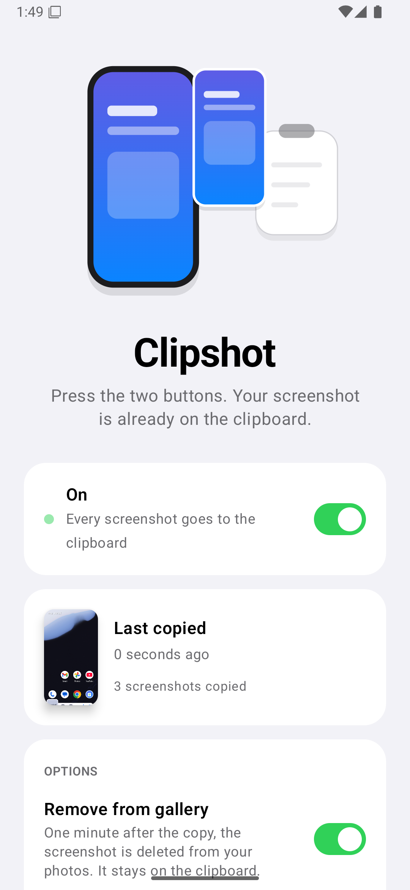
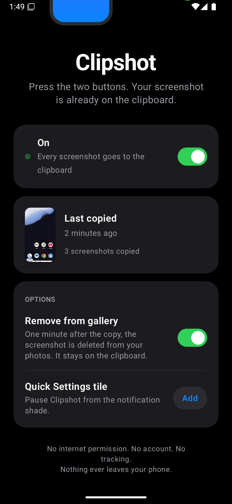

<p align="center"> &nbsp; </p>

# Clipshot

**Press the two buttons. Your screenshot is already on the clipboard.**

Clipshot copies every new screenshot to the clipboard the moment Android saves it. Take a screenshot, switch to your chat, paste. That's the whole app.

It is not a screenshot tool: Android takes the screenshot as usual, Clipshot only hands it to the clipboard.

## Why trust it

| | |
|---|---|
| No internet permission | The app cannot open a network connection. Check `AndroidManifest.xml`, or the permissions screen once installed. |
| No background service | Android wakes Clipshot only when an image is saved (a JobScheduler content trigger). No persistent notification, no battery drain. |
| One permission | Read images, to see new screenshots. Only system screenshots from the last 30 seconds are looked at. |
| Nothing leaves the phone | No account, no analytics, no ads, no cloud backup, no device-to-device transfer of its data. |
| Reproducible builds | Two builds of the same commit produce byte-identical APKs. |

## Features

- Every new screenshot goes to the clipboard, ready to paste anywhere that accepts images.
- **Remove from gallery** (optional): one minute after the copy, the screenshot is deleted from your photos and only lives on the clipboard. It needs "All files access", requested only when you turn this on, and used for nothing else. Only files saved by the system screenshot app are ever deleted, and only if they are untouched.
- **Quick Settings tile** to pause and resume.
- Light and dark themes, English and French.

## Install

Android 11 or newer. Built and tested for GrapheneOS, works on any Android.

- [Obtainium](https://github.com/ImranR98/Obtainium): add this repository's URL; Obtainium installs Clipshot from the releases and keeps it up to date.
- Or download the APK from [Releases](../../releases) and check its SHA-256 against the `.sha256` file published next to it.

Clipshot cannot update itself, by design: it has no internet access.

Signing certificate SHA-256: see [SECURITY.md](SECURITY.md).

## How it works

1. `ShotJob` registers a JobScheduler job with a content trigger on `MediaStore.Images`. Android runs it only when the photo library changes.
2. The job looks for an image added in the last 30 seconds that a system screenshot app saved (`OWNER_PACKAGE_NAME`, see `Rules.kt`). While the screenshot is still being written, it waits for it (up to 10 s).
3. It copies the image into the app's private storage and puts a `content://` URI on the clipboard. `ShotProvider` is not exported: the app you paste into gets one-off read access through the clipboard grant, and nothing else.
4. The last three copies are kept so the clipboard stays valid; older ones are deleted.

The whole app is about 600 lines of Kotlin. Read `Rules.kt`, `Shots.kt` and `ShotProvider.kt` first.

## Build

```bash
JAVA_HOME=/path/to/jdk-21 ./gradlew :app:testDebugUnitTest :app:lintRelease :app:assembleRelease
```

Release signing reads `~/.clipshot/keystore.properties` if present; otherwise the release APK is unsigned. To check reproducibility, build the same commit twice from two clones with `-Punsigned` and compare the SHA-256 of `app-release-unsigned.apk`.

`pastecheck/` is a tiny test app that reads the clipboard the way a messaging app would, to check pasting end to end on a device or emulator.

## Contributing

See [CONTRIBUTING.md](CONTRIBUTING.md). Security issues: [SECURITY.md](SECURITY.md). Privacy: [PRIVACY.md](PRIVACY.md).

## License

[Apache-2.0](LICENSE)
